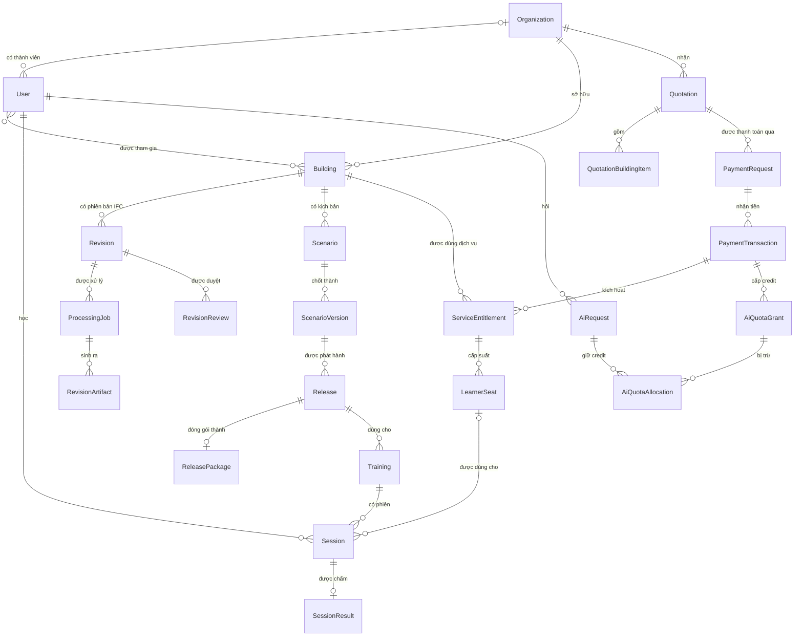
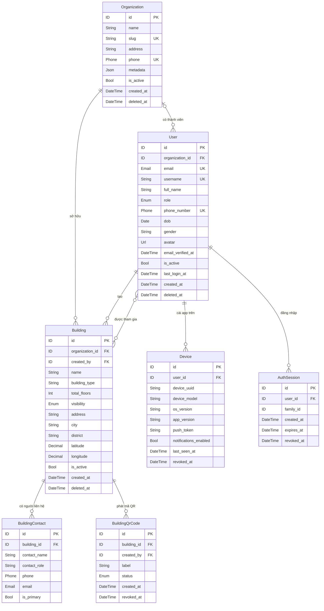
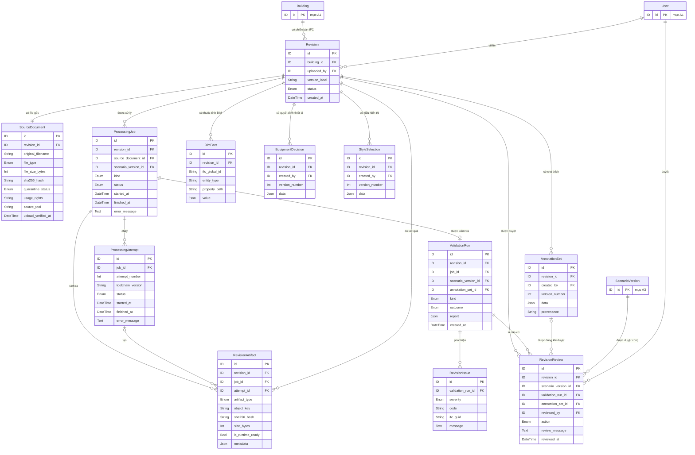
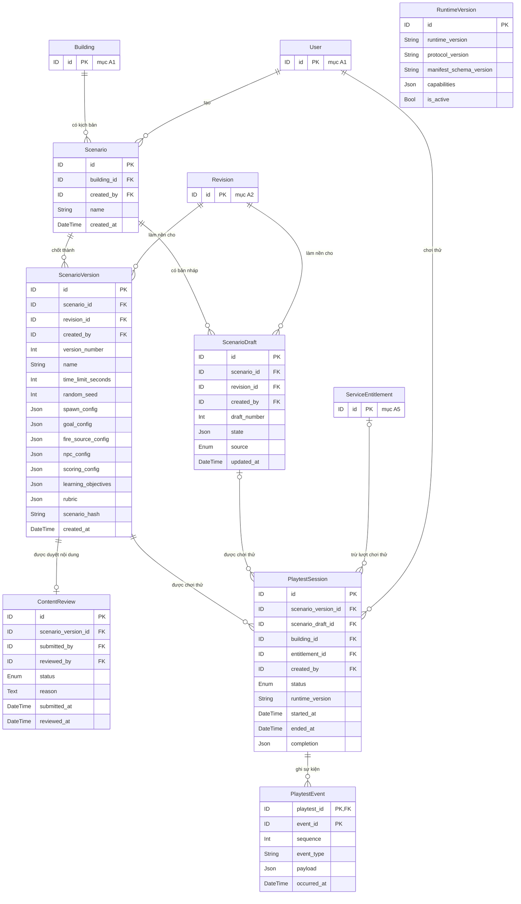
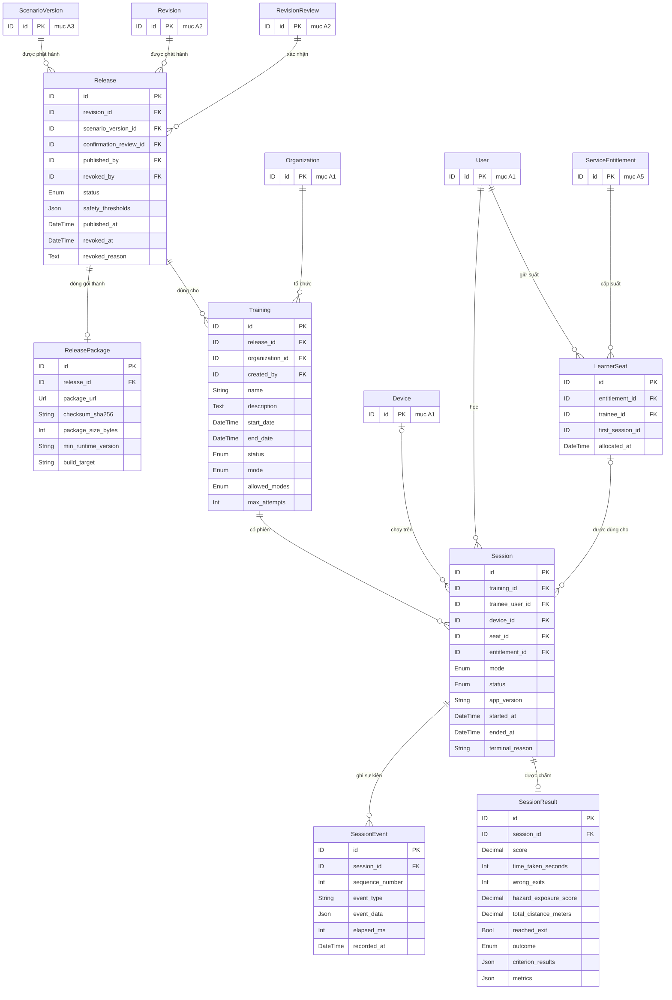
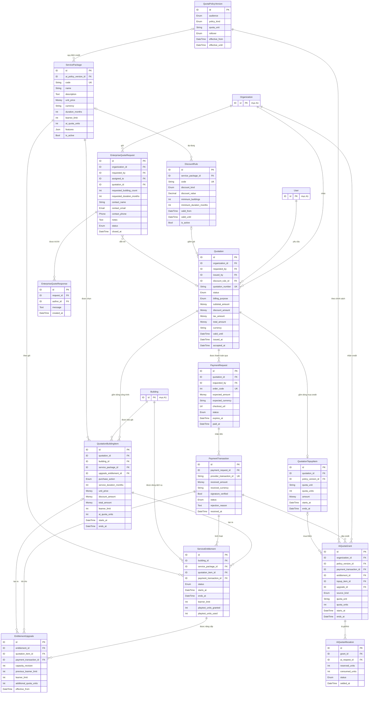
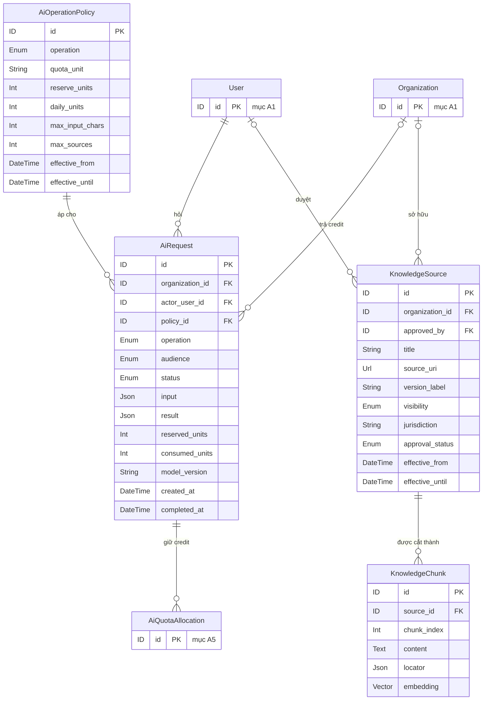
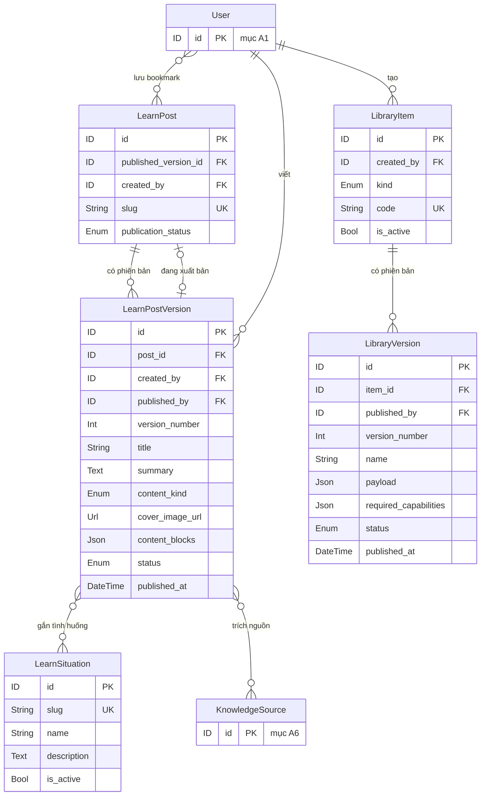
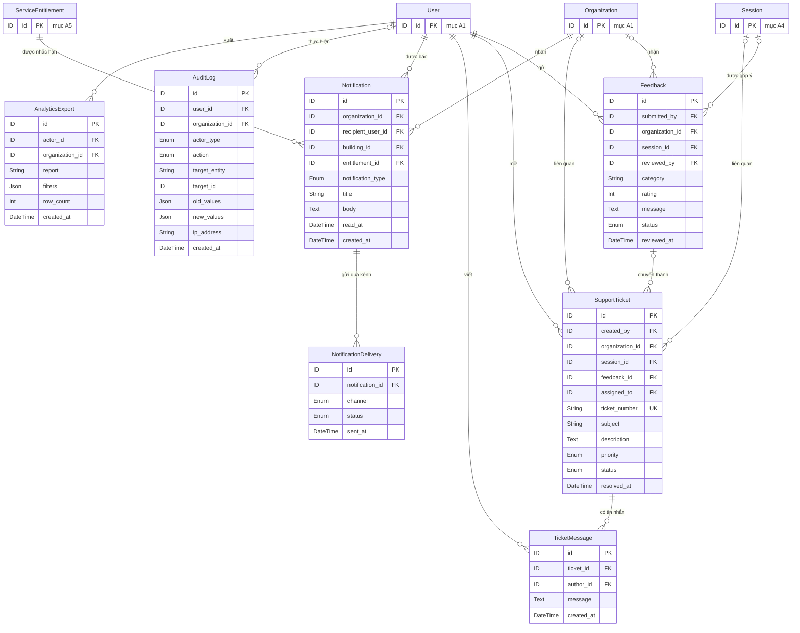

# Fire3D — Mô hình dữ liệu Logical

> Bắt đầu từ [0-Ke-hoach-ve.md](0-Ke-hoach-ve.md): danh sách hình cần vẽ, các bước và checklist.

Sinh từ schema PostgreSQL thật trên production (Supabase Singapore, đối chiếu ngày 27/10/2026, 136 migration; đã bỏ trước bảng `revision_processing_logs` và 2 enum của nó, xóa ở đợt dọn dẹp cùng ngày). **Logical:** 63 thực thể, 4 quan hệ nhiều-nhiều. **Physical:** 112 bảng, 1289 cột, 244 khóa ngoại, 16 kiểu enum (chưa tính bảng hệ thống `__EFMigrationsHistory` của EF Core).

## Mục lục

- [Ký hiệu bản số](#ký-hiệu-bản-số)
- [Logical khác Physical ở đâu](#logical-khác-physical-ở-đâu)
- [A0. Tổng quan](#a0-tổng-quan)
- [A1. Tổ chức, người dùng & công trình](#a1-tổ-chức-người-dùng--công-trình)
- [A2. Mô hình IFC & xử lý](#a2-mô-hình-ifc--xử-lý)
- [A3. Kịch bản & chơi thử](#a3-kịch-bản--chơi-thử)
- [A4. Phát hành, huấn luyện & phiên học](#a4-phát-hành-huấn-luyện--phiên-học)
- [A5. Báo giá, thanh toán & dịch vụ](#a5-báo-giá-thanh-toán--dịch-vụ)
- [A6. AI & kho tri thức](#a6-ai--kho-tri-thức)
- [A7. Learn & thư viện](#a7-learn--thư-viện)
- [A8. Hỗ trợ, thông báo & audit](#a8-hỗ-trợ-thông-báo--audit)
- [Từ điển thực thể](#từ-điển-thực-thể)
- [Bảng không đưa vào logical](#bảng-không-đưa-vào-logical)

## Ký hiệu bản số

Mọi sơ đồ dùng ký hiệu chân chim (crow's foot) của Mermaid:

| Ký hiệu | Nghĩa |
|---|---|
| `\|\|--o{` | Một – nhiều (bên một bắt buộc, bên nhiều có thể 0) |
| `\|o--o{` | Không/một – nhiều (khóa ngoại cho phép NULL) |
| `\|\|--o\|` | Một – không/một (quan hệ 1:1, phía con có ràng buộc UNIQUE) |
| `\|\|--\|\|` | Một – đúng một |
| `}o--o{` | Nhiều – nhiều (chỉ có ở logical; physical tách thành bảng trung gian) |

## Logical khác Physical ở đâu

| | Logical (file này) | Physical (`2-Physical.md`) |
|---|---|---|
| Mục đích | Mô tả **nghiệp vụ**: có những đối tượng nào và chúng liên quan ra sao | Mô tả **cách lưu thật** trong PostgreSQL |
| Phạm vi | 63 thực thể nghiệp vụ; bỏ các bảng kỹ thuật (hàng đợi, outbox, biên nhận, giữ chỗ...) | Đủ 112 bảng |
| Tên | Thực thể dạng `PascalCase` (`ServiceEntitlement`) | Bảng dạng `snake_case` số nhiều (`service_entitlements`) |
| Kiểu dữ liệu | Kiểu miền: `ID`, `String`, `Money`, `DateTime`, `Enum`, `Json`... | Kiểu PostgreSQL: `uuid`, `varchar(64)`, `numeric(14,2)`, `timestamptz`, enum riêng, `jsonb`, `vector` |
| Nhiều – nhiều | Vẽ thẳng `}o--o{` | Tách thành bảng trung gian có khóa chính ghép (xem dưới) |
| Quan hệ 1:1 phụ | Gộp vào thực thể chính (vị trí công trình nằm trong `Building`) | Bảng riêng, khóa ngoại có UNIQUE (`building_locations.building_id`) |
| Cột kỹ thuật | Bỏ: hash token, lease, `revision`/ETag, idempotency key, snapshot giá | Có đủ |
| Khóa ngoại | Chỉ khóa ngoại nghiệp vụ, mỗi quan hệ một khóa | Nhiều khóa ngoại **ghép** mang theo `organization_id` để database tự chặn dữ liệu chéo tổ chức (ví dụ `scenario_versions(scenario_id, building_id, organization_id)`) |

**Quan hệ nhiều-nhiều và bảng trung gian tương ứng:**

| Logical | Bảng trung gian (physical) | Khóa chính |
|---|---|---|
| `User` }o--o{ `Building` (được tham gia) | `building_participation_grants` | (building_id, trainee_user_id, access_revision) |
| `LearnPostVersion` }o--o{ `LearnSituation` (gắn tình huống) | `learn_post_version_situations` | (post_version_id, situation_id) |
| `LearnPostVersion` }o--o{ `KnowledgeSource` (trích nguồn) | `learn_post_version_sources` | (post_version_id, source_id, source_role) |
| `User` }o--o{ `LearnPost` (lưu bookmark) | `learn_bookmarks` | (trainee_user_id, post_id) |

## A0. Tổng quan

Chỉ các thực thể trên trục chính, chưa có thuộc tính. Dùng làm trang đầu của phần logical.

## A1. Tổ chức, người dùng & công trình

Ai dùng hệ thống, thuộc tổ chức nào, và tổ chức có những công trình nào. Học viên (Trainee) không thuộc tổ chức; họ được **tham gia** công trình qua mã QR, đó là quan hệ nhiều-nhiều.

*7 thực thể, 8 quan hệ.*

## A2. Mô hình IFC & xử lý

Mỗi công trình có nhiều phiên bản mô hình IFC. Một phiên bản được xử lý trên VM thành các kết quả (GLB, navmesh, danh sách tầng), được kiểm tra, rồi được duyệt cho huấn luyện.

*12 thực thể, 19 quan hệ. Thực thể chỉ có `id`: `Building`, `ScenarioVersion`, `User` (vẽ đầy đủ ở mục khác).*

## A3. Kịch bản & chơi thử

Kịch bản gắn với một công trình. Người soạn sửa bản nháp nhiều lần, rồi chốt thành **phiên bản bất biến**. Tổ chức chơi thử phiên bản đó trước khi phát hành.

*7 thực thể, 12 quan hệ. Thực thể chỉ có `id`: `Building`, `Revision`, `ServiceEntitlement`, `User` (vẽ đầy đủ ở mục khác).*

## A4. Phát hành, huấn luyện & phiên học

Phiên bản kịch bản đã duyệt được **phát hành** thành gói Android. Tổ chức tạo **bài huấn luyện** từ bản phát hành; học viên vào bài, mỗi lần chơi là một **phiên**, kết thúc thì được chấm điểm. Mỗi học viên chiếm một **suất** của dịch vụ công trình.

*7 thực thể, 14 quan hệ. Thực thể chỉ có `id`: `Device`, `Organization`, `Revision`, `RevisionReview`, `ScenarioVersion`, `ServiceEntitlement`, `User` (vẽ đầy đủ ở mục khác).*

## A5. Báo giá, thanh toán & dịch vụ

Tổ chức nhận **báo giá** (mỗi dòng là một công trình hoặc một lần mua thêm credit AI), trả tiền qua **PayOS**. Tiền về thì sinh ra **quyền dùng dịch vụ** cho công trình và **credit AI** cho tổ chức.

*14 thực thể, 26 quan hệ. Thực thể chỉ có `id`: `Building`, `Organization`, `User` (vẽ đầy đủ ở mục khác).*

## A6. AI & kho tri thức

Mỗi yêu cầu AI theo một **chính sách thao tác** và giữ trước credit từ các lô credit của tổ chức. Câu trả lời dựa trên **kho tri thức** (quy chuẩn PCCC) đã cắt đoạn và nhúng vector.

*4 thực thể, 7 quan hệ. Thực thể chỉ có `id`: `AiQuotaAllocation`, `Organization`, `User` (vẽ đầy đủ ở mục khác).*

## A7. Learn & thư viện

Bài viết Learn có nhiều phiên bản; một phiên bản gắn nhiều **tình huống** và trích nhiều **nguồn tri thức** (nhiều-nhiều). Học viên **lưu bookmark** bài viết. Thư viện dùng chung cũng quản lý theo phiên bản.

*5 thực thể, 8 quan hệ. Thực thể chỉ có `id`: `KnowledgeSource`, `User` (vẽ đầy đủ ở mục khác).*

## A8. Hỗ trợ, thông báo & audit

Góp ý và phiếu hỗ trợ (có thể gắn với một phiên học), thông báo nhắc hạn dịch vụ gửi qua nhiều kênh, và nhật ký thao tác.

*7 thực thể, 15 quan hệ. Thực thể chỉ có `id`: `Organization`, `ServiceEntitlement`, `Session`, `User` (vẽ đầy đủ ở mục khác).*

## Từ điển thực thể

Cột "Bảng physical" cho biết thực thể logical được lưu ở bảng nào. Thực thể có hai bảng trở lên là chỗ physical tách quan hệ 1:1 ra bảng riêng.

| Mục | Thực thể | Nghĩa | Bảng physical |
|---|---|---|---|
| A1 | `Organization` | Tổ chức khách hàng | `organizations` |
| A1 | `User` | Người dùng | `users` |
| A1 | `Device` | Thiết bị cài app | `user_devices` `device_installations` |
| A1 | `AuthSession` | Phiên đăng nhập | `auth_refresh_tokens` |
| A1 | `Building` | Công trình | `buildings` `building_locations` |
| A1 | `BuildingContact` | Người liên hệ của công trình | `building_contacts` |
| A1 | `BuildingQrCode` | Mã QR tham gia công trình | `building_qr_codes` |
| A2 | `Revision` | Phiên bản mô hình IFC | `revisions` |
| A2 | `SourceDocument` | File IFC gốc | `source_documents` |
| A2 | `ProcessingJob` | Lượt xử lý mô hình trên VM | `processing_jobs` |
| A2 | `ProcessingAttempt` | Lần chạy của một job | `processing_job_attempts` |
| A2 | `RevisionArtifact` | Kết quả xử lý (GLB, navmesh, tầng...) | `revision_artifacts` |
| A2 | `ValidationRun` | Lần kiểm tra mô hình/kịch bản | `validation_runs` |
| A2 | `RevisionIssue` | Lỗi phát hiện khi kiểm tra | `revision_issues` |
| A2 | `BimFact` | Thuộc tính BIM trích từ IFC | `bim_facts` |
| A2 | `AnnotationSet` | Bộ chú thích trên mô hình | `annotation_sets` |
| A2 | `EquipmentDecision` | Quyết định thiết bị PCCC | `revision_equipment_decisions` |
| A2 | `StyleSelection` | Lựa chọn hiển thị mô hình | `revision_style_selections` |
| A2 | `RevisionReview` | Duyệt mô hình cho huấn luyện | `revision_reviews` |
| A3 | `Scenario` | Kịch bản | `scenarios` |
| A3 | `ScenarioDraft` | Bản nháp kịch bản | `scenario_drafts` |
| A3 | `ScenarioVersion` | Phiên bản kịch bản (bất biến) | `scenario_versions` |
| A3 | `ContentReview` | Duyệt nội dung kịch bản | `scenario_content_reviews` |
| A3 | `RuntimeVersion` | Phiên bản app Unity được hỗ trợ | `runtime_compatibility_catalog` |
| A3 | `PlaytestSession` | Phiên chơi thử của tổ chức | `playtest_sessions` `playtest_runtime_state` `playtest_package_pins` |
| A3 | `PlaytestEvent` | Sự kiện trong phiên chơi thử | `playtest_events` |
| A4 | `Release` | Bản phát hành | `releases` `release_build_provenance` |
| A4 | `ReleasePackage` | Gói Android của bản phát hành | `release_packages` |
| A4 | `Training` | Bài huấn luyện | `trainings` |
| A4 | `Session` | Phiên học của học viên | `sessions` |
| A4 | `SessionEvent` | Sự kiện trong phiên học | `session_events` |
| A4 | `SessionResult` | Kết quả chấm điểm | `session_results` |
| A4 | `LearnerSeat` | Suất học viên của dịch vụ | `billing_learner_seats` |
| A5 | `ServicePackage` | Gói dịch vụ | `service_packages` |
| A5 | `DiscountRule` | Quy tắc giảm giá | `service_package_discount_rules` |
| A5 | `QuotaPolicyVersion` | Chính sách credit AI | `billing_quota_policy_versions` |
| A5 | `Quotation` | Báo giá | `quotations` |
| A5 | `QuotationBuildingItem` | Dòng báo giá cho một công trình | `quotation_building_items` |
| A5 | `QuotationTopupItem` | Dòng báo giá mua thêm credit AI | `quotation_topup_items` |
| A5 | `PaymentRequest` | Yêu cầu thanh toán PayOS | `payos_payment_requests` |
| A5 | `PaymentTransaction` | Giao dịch tiền đã nhận | `payment_transactions` |
| A5 | `ServiceEntitlement` | Quyền dùng dịch vụ của công trình | `service_entitlements` |
| A5 | `EntitlementUpgrade` | Nâng cấp dịch vụ | `billing_entitlement_upgrades` |
| A5 | `AiQuotaGrant` | Lô credit AI được cấp | `billing_ai_quota_grants` |
| A5 | `AiQuotaAllocation` | Credit giữ/trừ cho một yêu cầu AI | `billing_ai_quota_allocations` |
| A5 | `EnterpriseQuoteRequest` | Yêu cầu báo giá doanh nghiệp | `enterprise_quote_requests` |
| A5 | `EnterpriseQuoteResponse` | Phản hồi cho yêu cầu báo giá | `enterprise_quote_responses` |
| A6 | `AiOperationPolicy` | Chính sách cho từng loại thao tác AI | `ai_operation_policies` |
| A6 | `AiRequest` | Yêu cầu gửi AI | `ai_requests` |
| A6 | `KnowledgeSource` | Nguồn tri thức (quy chuẩn, tài liệu) | `knowledge_sources` |
| A6 | `KnowledgeChunk` | Đoạn tri thức đã nhúng vector | `knowledge_chunks` |
| A7 | `LearnSituation` | Tình huống học (chủ đề) | `learn_situations` |
| A7 | `LearnPost` | Bài viết Learn | `learn_posts` |
| A7 | `LearnPostVersion` | Phiên bản bài viết | `learn_post_versions` |
| A7 | `LibraryItem` | Mục thư viện dùng chung | `organization_library_items` |
| A7 | `LibraryVersion` | Phiên bản mục thư viện | `organization_library_versions` |
| A8 | `Feedback` | Góp ý | `feedback` |
| A8 | `SupportTicket` | Phiếu hỗ trợ | `support_tickets` |
| A8 | `TicketMessage` | Tin nhắn trong phiếu hỗ trợ | `support_ticket_messages` |
| A8 | `Notification` | Thông báo cho tổ chức | `organization_notifications` |
| A8 | `NotificationDelivery` | Lần gửi thông báo qua một kênh | `notification_deliveries` |
| A8 | `AuditLog` | Nhật ký thao tác | `audit_logs` |
| A8 | `AnalyticsExport` | Lần xuất báo cáo | `analytics_exports` |

## Bảng không đưa vào logical

40 bảng dưới đây có trong physical nhưng không phải đối tượng nghiệp vụ: chúng phục vụ chống gửi lặp, hàng đợi worker, hoặc các bước trung gian. Vẽ logical thì bỏ; vẽ physical thì có (`2-Physical.md`).

| Loại | Bảng |
|---|---|
| Mã/OTP tạm thời và hàng đợi gửi email | `auth_google_onboarding_sessions`, `registration_email_challenges`, `registration_otp_email_jobs`, `local_password_reset_tokens`, `password_reset_email_jobs`, `email_verification_tokens`, `email_verification_jobs` |
| Phiên tải file và dọn object trên S3 | `avatar_upload_intents`, `avatar_object_cleanups`, `ifc_upload_intents`, `ifc_upload_attempts`, `ifc_object_cleanup`, `learn_media_images`, `knowledge_source_files` |
| Outbox, giao job qua Redis/HTTP, kết quả tạm của worker | `integration_outbox_events`, `integration_event_consumptions`, `processing_delivery_receipts`, `processing_stream_deliveries`, `processing_stream_state`, `processing_stream_rejections`, `processing_stream_retry_receipts`, `processing_candidate_outputs` |
| Bước chuẩn bị trước khi vào phiên | `training_session_preparations`, `playtest_handoffs` |
| Quy trình thanh toán nhiều bước (checkout, giữ chỗ, webhook, cấp quyền) | `billing_checkout_operations`, `billing_service_reservations`, `billing_upgrade_reservations`, `payos_webhook_inbox`, `payment_provisioning_records` |
| Biên nhận chống gửi lặp (Idempotency-Key) | `ai_command_receipts`, `application_command_receipts`, `authoring_command_receipts`, `billing_command_receipts`, `content_command_receipts`, `learner_command_receipts`, `playtest_command_receipts`, `processing_command_receipts`, `readiness_command_receipts`, `release_command_receipts`, `support_command_receipts` |
