# Fire3D — Mô hình dữ liệu Physical

> Bắt đầu từ [0-Ke-hoach-ve.md](0-Ke-hoach-ve.md): danh sách hình cần vẽ, các bước và checklist.

Sinh từ schema PostgreSQL thật trên production (Supabase Singapore, đối chiếu ngày 27/10/2026, 136 migration; đã bỏ trước bảng `revision_processing_logs` và 2 enum của nó, xóa ở đợt dọn dẹp cùng ngày). **Logical:** 63 thực thể, 4 quan hệ nhiều-nhiều. **Physical:** 112 bảng, 1289 cột, 244 khóa ngoại, 16 kiểu enum (chưa tính bảng hệ thống `__EFMigrationsHistory` của EF Core).

## Mục lục

- [Quy ước](#quy-ước)
- [Kiểu enum](#kiểu-enum)
- [B1. Định danh & phiên đăng nhập](#b1-định-danh--phiên-đăng-nhập)
- [B2. Công trình & quyền truy cập](#b2-công-trình--quyền-truy-cập)
- [B3. IFC & xử lý (worker)](#b3-ifc--xử-lý-worker)
- [B4. Outbox & giao job (Redis/HTTP)](#b4-outbox--giao-job-redishttp)
- [B5. Kịch bản & playtest](#b5-kịch-bản--playtest)
- [B6. Phát hành & bài huấn luyện](#b6-phát-hành--bài-huấn-luyện)
- [B7. Phiên học viên & chấm điểm](#b7-phiên-học-viên--chấm-điểm)
- [B8. Báo giá, PayOS & dịch vụ](#b8-báo-giá-payos--dịch-vụ)
- [B9. AI & kho tri thức](#b9-ai--kho-tri-thức)
- [B10. Learn & thư viện tổ chức](#b10-learn--thư-viện-tổ-chức)
- [B11. Hỗ trợ, thông báo, audit](#b11-hỗ-trợ-thông-báo-audit)
- [B12. Biên nhận idempotency](#b12-biên-nhận-idempotency)
- [Bảng hệ thống](#bảng-hệ-thống)

## Quy ước

- Mỗi cột ghi `kiểu tên khóa "ghi chú"`. Khóa: `PK` khóa chính, `FK` khóa ngoại, `UK` UNIQUE một cột. Ghi chú `NULL` là cột cho phép NULL; cột không ghi là **NOT NULL**. `numeric` ghi độ chính xác trong ghi chú, ví dụ `"(14,2)"`.
- Viết tắt kiểu: `timestamptz` = `timestamp with time zone`, `varchar(n)` = `character varying(n)`, `int` = `integer`, `bool` = `boolean`.
- Nhãn trên đường nối là **cột khóa ngoại** ở bảng con. Bản số suy ra từ schema: khóa ngoại NULL được thì phía cha là `|o`; khóa ngoại trùng một UNIQUE thì phía con là `o|` (1:1).
- Bảng thuộc nhóm khác chỉ vẽ cột khóa chính, ghi chú số nhóm. Ký hiệu bản số giải thích ở `1-Logical.md`.
- UNIQUE nhiều cột, index một phần (có `WHERE`) và CHECK có đủ trong `Fire3D-Physical.dbml`.

## Kiểu enum

| Enum | Giá trị |
|---|---|
| `audit_action_enum` | Upload, ConfirmForTraining, Reject, Publish, Revoke, Sync, Login, Logout, Download, Delete, Create, Update, Rollback, Grant, Resume, Payment, Support |
| `feedback_status_enum` | Submitted, Reviewed, Closed |
| `file_type_enum` | IFC |
| `payment_request_status_enum` | Pending, Paid, Expired, Cancelled, Failed |
| `payment_transaction_status_enum` | Received, Verified, Rejected, Applied |
| `quarantine_status_enum` | Pending, Accepted, Rejected |
| `quotation_status_enum` | Draft, Issued, Accepted, Expired, Cancelled |
| `release_status_enum` | Built, Published, Superseded, Revoked |
| `review_action_enum` | ConfirmForTraining, Rejected |
| `revision_status_enum` | Draft, Uploaded, Processing, NeedsFix, ReadyForScenario, ConfirmedForTraining, Rejected, Failed, Superseded |
| `session_mode_enum` | Learn, Guided, Assessment |
| `session_status_enum` | Created, Launching, Running, Completed, CompletedWithSupersededRelease, ScenarioUnsurvivable, Aborted, Abandoned, Crashed |
| `support_priority_enum` | Low, Normal, High, Urgent |
| `support_ticket_status_enum` | Open, InProgress, Resolved, Closed |
| `training_status_enum` | Draft, Active, Closed, Archived |
| `user_role_enum` | PlatformAdmin, OrganizationUser, Trainee |

## B1. Định danh & phiên đăng nhập

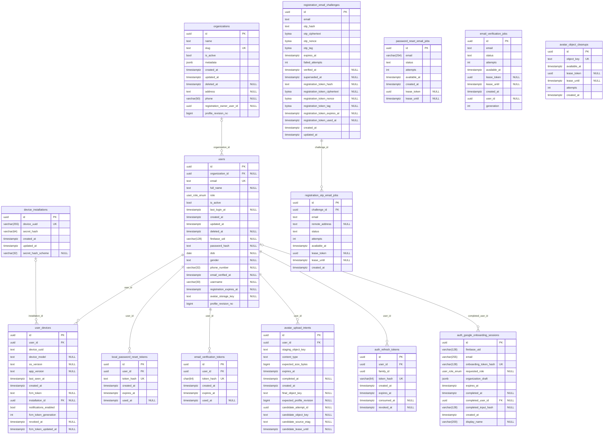
*14 bảng, 9 khóa ngoại.*

- **UNIQUE nhiều cột:** `user_devices(id, user_id)`; `user_devices(user_id, device_uuid)`
- **Xóa dây chuyền:** `registration_otp_email_jobs` → `registration_email_challenges` ON DELETE CASCADE; `local_password_reset_tokens` → `users` ON DELETE CASCADE; `email_verification_tokens` → `users` ON DELETE CASCADE; `avatar_upload_intents` → `users` ON DELETE CASCADE

## B2. Công trình & quyền truy cập

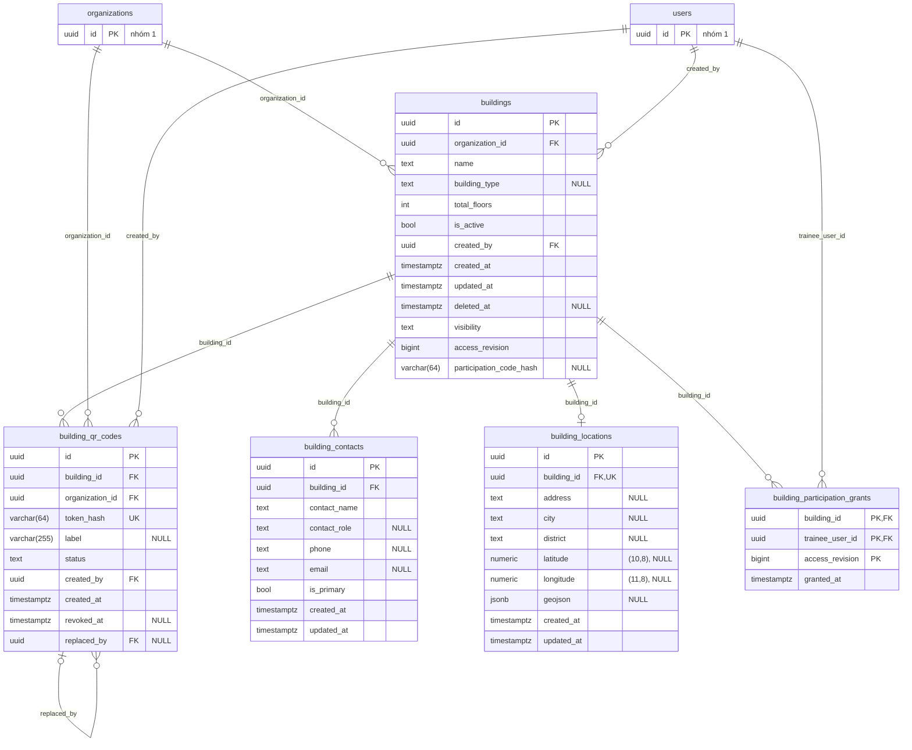
*5 bảng, 10 khóa ngoại, 2 bảng ở nhóm khác.*

- **UNIQUE nhiều cột:** `buildings(id, organization_id)`

## B3. IFC & xử lý (worker)

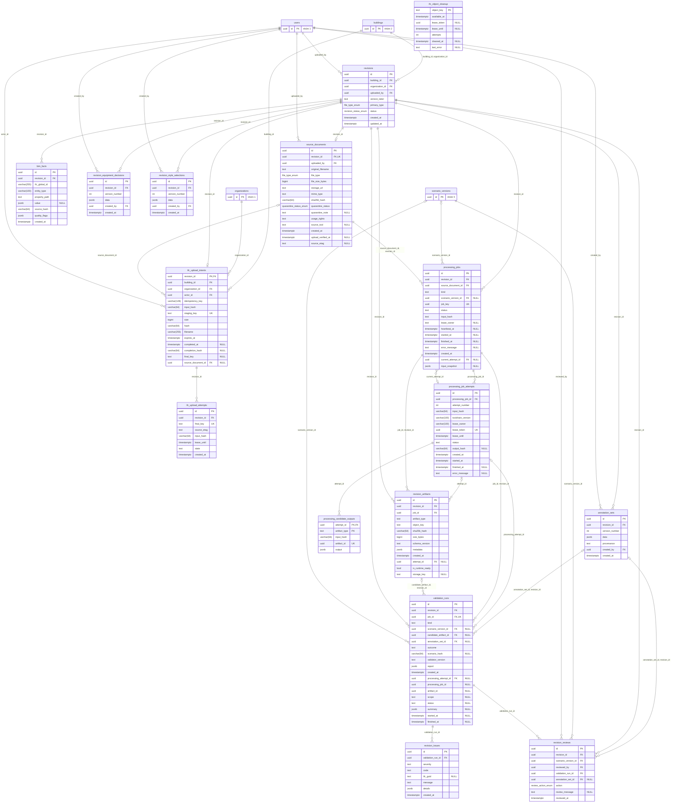
*16 bảng, 38 khóa ngoại, 4 bảng ở nhóm khác.*

- **UNIQUE nhiều cột:** `revisions(building_id, version_label)`; `revisions(id, building_id, organization_id)`; `revisions(id, organization_id)`; `source_documents(id, revision_id)`; `ifc_upload_intents(actor_id, idempotency_key)`; `processing_jobs(id, revision_id)`; `processing_job_attempts(id, processing_job_id)`; `processing_job_attempts(processing_job_id, attempt_number)`; `revision_artifacts(id, revision_id)`; `revision_artifacts(job_id, artifact_type, sha256_hash)`; `bim_facts(revision_id, ifc_global_id, property_path)`; `revision_equipment_decisions(revision_id, version_number)`; `revision_style_selections(revision_id, version_number)`; `annotation_sets(id, revision_id)`; `annotation_sets(revision_id, version_number)`; `revision_reviews(validation_run_id, action)`
- **Xóa dây chuyền:** `bim_facts` → `revisions` ON DELETE CASCADE

## B4. Outbox & giao job (Redis/HTTP)

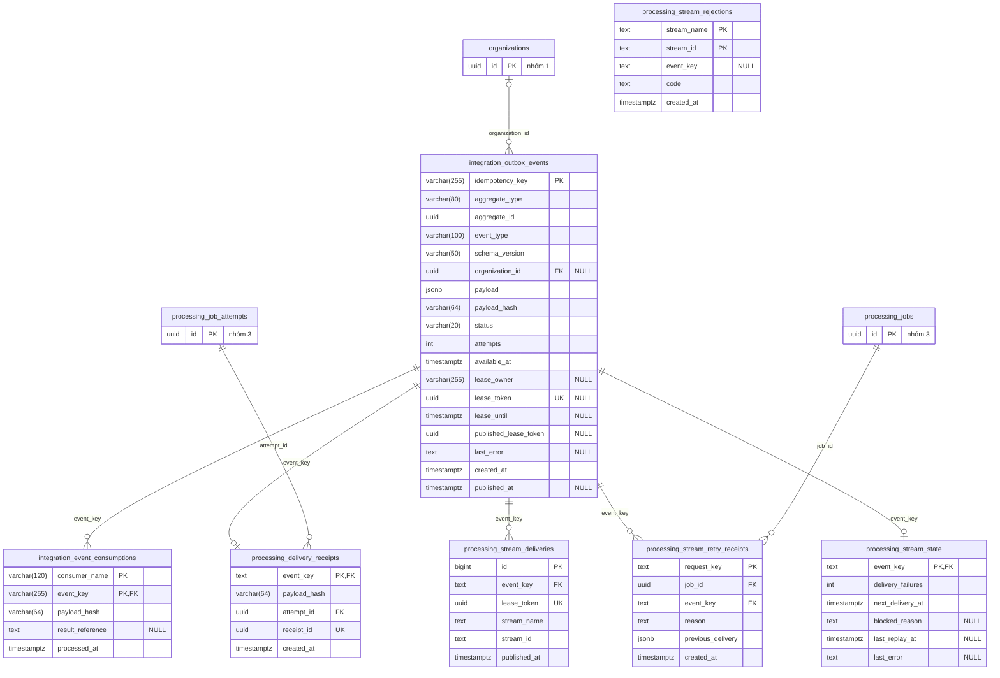
*7 bảng, 8 khóa ngoại, 3 bảng ở nhóm khác.*

- **UNIQUE nhiều cột:** `processing_stream_deliveries(stream_name, stream_id)`

## B5. Kịch bản & playtest

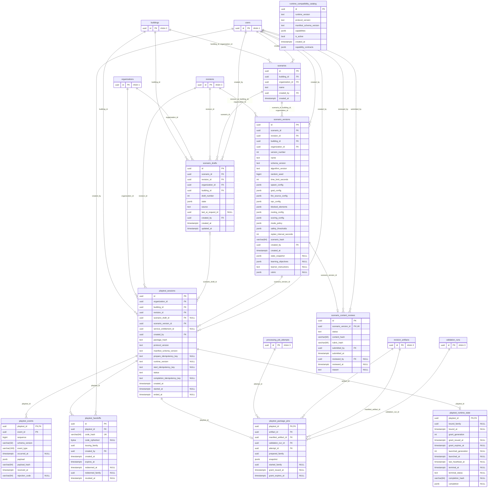
*10 bảng, 28 khóa ngoại, 7 bảng ở nhóm khác.*

- **UNIQUE nhiều cột:** `scenarios(id, building_id, organization_id)`; `scenario_versions(id, revision_id, organization_id)`; `scenario_versions(scenario_id, version_number)`; `playtest_events(playtest_id, sequence)`
- **Xóa dây chuyền:** `scenario_drafts` → `buildings` ON DELETE CASCADE; `scenario_drafts` → `organizations` ON DELETE CASCADE; `scenario_drafts` → `revisions` ON DELETE CASCADE; `scenario_drafts` → `scenarios` ON DELETE CASCADE; `scenario_drafts` → `users` ON DELETE CASCADE; `playtest_sessions` → `buildings` ON DELETE CASCADE; `playtest_sessions` → `organizations` ON DELETE CASCADE; `playtest_sessions` → `revisions` ON DELETE CASCADE; `playtest_sessions` → `scenario_versions` ON DELETE CASCADE; `playtest_sessions` → `users` ON DELETE CASCADE

## B6. Phát hành & bài huấn luyện

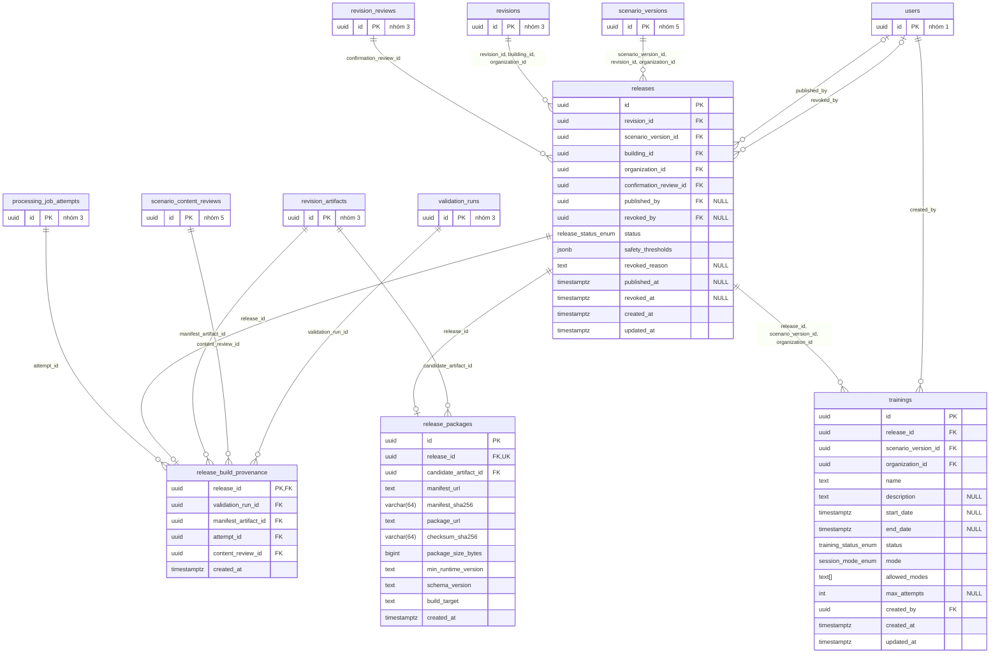
*4 bảng, 14 khóa ngoại, 8 bảng ở nhóm khác.*

- **UNIQUE nhiều cột:** `releases(id, scenario_version_id, organization_id)`; `releases(revision_id, scenario_version_id)`; `trainings(id, release_id, organization_id)`; `trainings(id, release_id, scenario_version_id, organization_id)`

## B7. Phiên học viên & chấm điểm

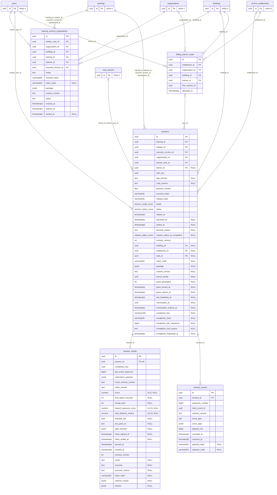
*5 bảng, 16 khóa ngoại, 6 bảng ở nhóm khác.*

- **UNIQUE nhiều cột:** `sessions(trainee_user_id, start_key)`; `session_events(session_id, client_event_id)`; `session_events(session_id, sequence_number)`; `billing_learner_seats(entitlement_id, trainee_id)`

## B8. Báo giá, PayOS & dịch vụ

```mermaid
erDiagram
  billing_ai_quota_grants ||--o{ billing_ai_quota_allocations : "grant_id"
  billing_checkout_operations ||--o{ billing_service_reservations : "checkout_id"
  billing_checkout_operations ||--o{ billing_upgrade_reservations : "checkout_id"
  billing_entitlement_upgrades |o--o| billing_ai_quota_grants : "upgrade_id"
  billing_quota_policy_versions ||--o{ billing_ai_quota_grants : "policy_version_id"
  billing_quota_policy_versions |o--o{ quotation_building_items : "ai_policy_version_id"
  billing_quota_policy_versions |o--o{ quotation_topup_items : "policy_version_id"
  billing_quota_policy_versions |o--o{ service_packages : "ai_policy_version_id"
  buildings ||--o{ billing_service_reservations : "building_id"
  buildings ||--o{ quotation_building_items : "building_id"
  buildings ||--o{ service_entitlements : "building_id"
  enterprise_quote_requests ||--o{ enterprise_quote_responses : "request_id"
  organizations ||--o{ billing_ai_quota_allocations : "organization_id"
  organizations ||--o{ billing_ai_quota_grants : "organization_id"
  organizations ||--o{ billing_service_reservations : "organization_id"
  organizations ||--o{ enterprise_quote_requests : "organization_id"
  organizations ||--o{ payment_provisioning_records : "organization_id"
  organizations ||--o{ payos_payment_requests : "organization_id"
  organizations ||--o{ quotation_topup_items : "organization_id"
  organizations ||--o{ quotations : "organization_id"
  organizations ||--o{ service_entitlements : "organization_id"
  payment_transactions ||--o{ billing_ai_quota_grants : "payment_transaction_id"
  payment_transactions ||--o{ billing_entitlement_upgrades : "payment_transaction_id"
  payment_transactions ||--o{ payment_provisioning_records : "payment_transaction_id"
  payment_transactions |o--o{ payos_payment_requests : "paid_transaction_id, id"
  payment_transactions |o--o{ service_entitlements : "payment_transaction_id"
  payos_payment_requests |o--o{ billing_checkout_operations : "payment_request_id"
  payos_payment_requests ||--o{ payment_transactions : "payment_request_id"
  quotation_building_items |o--o{ billing_ai_quota_grants : "quotation_item_id"
  quotation_building_items ||--o{ billing_entitlement_upgrades : "quotation_item_id"
  quotation_building_items ||--o{ billing_service_reservations : "quotation_item_id"
  quotation_building_items ||--o{ billing_upgrade_reservations : "quotation_item_id"
  quotation_building_items |o--o{ service_entitlements : "quotation_item_id, quotation_id"
  quotation_topup_items |o--o{ billing_ai_quota_grants : "topup_item_id"
  quotations ||--o{ billing_checkout_operations : "quotation_id"
  quotations |o--o{ enterprise_quote_requests : "quotation_id"
  quotations ||--o{ payment_provisioning_records : "quotation_id"
  quotations ||--o{ payos_payment_requests : "quotation_id"
  quotations ||--o{ quotation_building_items : "quotation_id"
  quotations ||--o| quotation_topup_items : "quotation_id"
  quotations |o--o{ service_entitlements : "quotation_id"
  service_entitlements |o--o{ billing_ai_quota_grants : "entitlement_id"
  service_entitlements ||--o{ billing_entitlement_upgrades : "entitlement_id"
  service_entitlements ||--o{ billing_upgrade_reservations : "entitlement_id"
  service_entitlements |o--o{ quotation_building_items : "upgrade_entitlement_id"
  service_package_discount_rules |o--o{ quotations : "discount_rule_id"
  service_packages ||--o{ quotation_building_items : "service_package_id"
  service_packages |o--o{ quotations : "service_package_id"
  service_packages ||--o{ service_entitlements : "service_package_id"
  service_packages |o--o{ service_package_discount_rules : "service_package_id"
  users ||--o{ billing_checkout_operations : "actor_id"
  users ||--o{ billing_quota_policy_versions : "created_by"
  users |o--o{ enterprise_quote_requests : "assigned_to"
  users |o--o{ enterprise_quote_requests : "closed_by"
  users ||--o{ enterprise_quote_requests : "requested_by"
  users ||--o{ enterprise_quote_responses : "author_id"
  users ||--o{ payos_payment_requests : "requested_by"
  users |o--o{ quotations : "issued_by"
  users ||--o{ quotations : "requested_by"
  users ||--o{ service_entitlements : "created_by"
  users ||--o{ service_package_discount_rules : "created_by"
  users ||--o{ service_packages : "created_by"
  service_packages {
    uuid id PK
    varchar(50) code UK
    varchar(255) name
    text description "NULL"
    numeric unit_price "(14,2)"
    varchar(3) currency
    int duration_months "NULL"
    jsonb features
    bool is_active
    uuid created_by FK
    timestamptz created_at
    timestamptz updated_at
    bigint revision
    int commercial_version
    int learner_limit "NULL"
    int ai_quota_units "NULL"
    uuid ai_policy_version_id FK "NULL"
  }
  service_package_discount_rules {
    uuid id PK
    uuid service_package_id FK "NULL"
    varchar(80) code UK
    varchar(20) discount_kind
    numeric discount_value "(14,2)"
    varchar(3) discount_currency "NULL"
    int minimum_buildings
    int minimum_duration_months "NULL"
    timestamptz valid_from
    timestamptz valid_until "NULL"
    bool is_active
    uuid created_by FK
    timestamptz created_at
    timestamptz updated_at
    bigint revision
  }
  billing_quota_policy_versions {
    uuid id PK
    text audience
    text policy_kind
    text quota_unit
    timestamptz effective_from
    timestamptz effective_until "NULL"
    text rollover
    uuid created_by FK
    timestamptz created_at
  }
  quotations {
    uuid id PK
    uuid organization_id FK
    uuid service_package_id FK "NULL"
    uuid requested_by FK
    uuid issued_by FK "NULL"
    varchar(50) quotation_number UK
    quotation_status_enum status
    int quantity
    numeric unit_price "(14,2)"
    numeric subtotal_amount "(14,2)"
    numeric tax_amount "(14,2)"
    numeric discount_amount "(14,2)"
    numeric total_amount "(14,2)"
    varchar(3) currency
    timestamptz valid_until
    timestamptz issued_at "NULL"
    timestamptz accepted_at "NULL"
    timestamptz created_at
    timestamptz updated_at
    varchar(30) billing_purpose
    uuid discount_rule_id FK "NULL"
    jsonb discount_snapshot
    jsonb price_snapshot
    jsonb terms_snapshot
    bigint revision
    int commercial_version
  }
  quotation_building_items {
    uuid id PK
    uuid quotation_id FK
    uuid building_id FK
    uuid service_package_id FK
    varchar(20) purchase_action
    int service_duration_months
    numeric unit_price "(14,2)"
    numeric discount_amount "(14,2)"
    numeric subtotal_amount "(14,2)"
    numeric total_amount "(14,2)"
    varchar(3) currency
    jsonb price_snapshot
    jsonb terms_snapshot
    jsonb discount_snapshot
    varchar(255) line_provisioning_key UK "NULL"
    timestamptz created_at
    timestamptz updated_at
    int commercial_version
    bigint package_revision "NULL"
    int learner_limit "NULL"
    int ai_quota_units "NULL"
    uuid ai_policy_version_id FK "NULL"
    text ai_quota_unit "NULL"
    timestamptz starts_at "NULL"
    timestamptz ends_at "NULL"
    text pricing_basis
    uuid upgrade_entitlement_id FK "NULL"
    int upgrade_base_capacity_revision "NULL"
    int upgrade_previous_learner_limit "NULL"
  }
  quotation_topup_items {
    uuid id PK
    uuid quotation_id FK, UK
    uuid organization_id FK
    int requested_quota_units "NULL"
    uuid policy_version_id FK "NULL"
    text quota_unit "NULL"
    int quota_units "NULL"
    numeric amount "(14,2), NULL"
    timestamptz starts_at "NULL"
    timestamptz ends_at "NULL"
    text line_provisioning_key UK
    timestamptz created_at
    timestamptz updated_at
  }
  billing_checkout_operations {
    uuid id PK
    uuid quotation_id FK
    uuid actor_id FK
    varchar(128) idempotency_key
    varchar(64) input_hash
    bigint order_code UK
    varchar(30) status
    uuid lease_token "NULL"
    timestamptz lease_until "NULL"
    jsonb provider_result "NULL"
    timestamptz created_at
    timestamptz updated_at
    jsonb provider_input
    varchar(100) payment_link_id "NULL"
    uuid payment_request_id FK "NULL"
    timestamptz expires_at "NULL"
    int attempts
    timestamptz next_attempt_at
    varchar(80) last_error "NULL"
    bool cancel_requested
    uuid session_family_id "NULL"
  }
  billing_service_reservations {
    uuid id PK
    uuid checkout_id FK
    uuid quotation_item_id FK
    uuid building_id FK
    uuid organization_id FK
    timestamptz starts_at
    timestamptz ends_at
    text status
    timestamptz created_at
    timestamptz updated_at
  }
  billing_upgrade_reservations {
    uuid id PK
    uuid checkout_id FK
    uuid quotation_item_id FK
    uuid entitlement_id FK
    int base_capacity_revision
    text status
    timestamptz created_at
    timestamptz updated_at
  }
  payos_payment_requests {
    uuid id PK, FK
    uuid quotation_id FK
    uuid organization_id FK
    uuid requested_by FK
    bigint order_code UK
    numeric expected_amount "(14,2)"
    varchar(3) expected_currency
    text checkout_url
    text return_url
    text cancel_url
    payment_request_status_enum status
    uuid paid_transaction_id FK, UK "NULL"
    timestamptz expires_at "NULL"
    timestamptz paid_at "NULL"
    timestamptz created_at
    timestamptz updated_at
    varchar(255) idempotency_key
    varchar(100) payment_link_id "NULL"
  }
  payos_webhook_inbox {
    uuid id PK
    varchar(255) event_key UK
    varchar(64) input_hash
    bigint order_code
    jsonb payload
    timestamptz verified_at
    varchar(30) status
    int attempts
    uuid lease_token "NULL"
    timestamptz lease_until "NULL"
    timestamptz next_attempt_at
    timestamptz created_at
    varchar(80) last_error "NULL"
    timestamptz processed_at "NULL"
  }
  payment_transactions {
    uuid id PK
    uuid payment_request_id FK
    varchar(255) webhook_event_id UK
    varchar(255) provider_transaction_id UK "NULL"
    bigint received_order_code
    numeric received_amount "(14,2)"
    varchar(3) received_currency
    bool signature_verified
    payment_transaction_status_enum status
    jsonb raw_payload
    text rejection_reason "NULL"
    timestamptz received_at
    timestamptz signature_verified_at "NULL"
    timestamptz processed_at "NULL"
  }
  payment_provisioning_records {
    uuid id PK
    uuid payment_transaction_id FK
    uuid quotation_id FK
    uuid quotation_item_id
    uuid organization_id FK
    varchar(255) provisioning_key UK
    varchar(30) status
    int attempts
    text last_error "NULL"
    timestamptz provisioned_at "NULL"
    timestamptz created_at
    timestamptz updated_at
    uuid lease_token "NULL"
    timestamptz lease_until "NULL"
    timestamptz next_attempt_at
  }
  service_entitlements {
    uuid id PK
    uuid organization_id FK
    uuid building_id FK
    uuid service_package_id FK
    uuid quotation_id FK "NULL"
    uuid quotation_item_id FK "NULL"
    uuid payment_transaction_id FK "NULL"
    varchar(255) provisioning_key UK
    varchar(30) status
    timestamptz starts_at
    timestamptz ends_at
    jsonb price_snapshot
    jsonb terms_snapshot
    int playtest_units_granted
    int playtest_units_used
    uuid created_by FK
    timestamptz created_at
    int commercial_version
    int learner_limit "NULL"
  }
  billing_entitlement_upgrades {
    uuid id PK
    uuid entitlement_id FK
    int capacity_revision
    int previous_learner_limit
    int learner_limit
    int additional_quota_units
    timestamptz effective_from
    uuid quotation_item_id FK
    uuid payment_transaction_id FK
    text provisioning_key UK
    timestamptz created_at
  }
  billing_ai_quota_grants {
    uuid id PK
    uuid organization_id FK
    uuid policy_version_id FK
    text quota_unit
    int quota_units
    timestamptz starts_at
    timestamptz ends_at
    uuid quotation_item_id FK "NULL"
    uuid payment_transaction_id FK
    uuid entitlement_id FK "NULL"
    text provisioning_key UK
    text rollover
    timestamptz created_at
    text source_kind
    uuid upgrade_id FK, UK "NULL"
    uuid topup_item_id FK "NULL"
  }
  billing_ai_quota_allocations {
    uuid id PK
    uuid grant_id FK
    uuid organization_id FK
    uuid request_id
    text quota_unit
    int reserved_units
    int consumed_units "NULL"
    text status
    timestamptz created_at
    timestamptz settled_at "NULL"
  }
  enterprise_quote_requests {
    uuid id PK
    uuid organization_id FK
    uuid requested_by FK
    int requested_building_count
    int requested_duration_months "NULL"
    text contact_name
    varchar(255) contact_email
    varchar(50) contact_phone "NULL"
    text notes "NULL"
    varchar(20) status
    uuid quotation_id FK "NULL"
    varchar(255) idempotency_key UK
    timestamptz created_at
    timestamptz updated_at
    bigint revision
    uuid assigned_to FK "NULL"
    timestamptz closed_at "NULL"
    uuid closed_by FK "NULL"
    text close_reason "NULL"
  }
  enterprise_quote_responses {
    uuid id PK
    uuid request_id FK
    uuid author_id FK
    text message
    timestamptz created_at
  }
  buildings {
    uuid id PK "nhóm 2"
  }
  organizations {
    uuid id PK "nhóm 1"
  }
  users {
    uuid id PK "nhóm 1"
  }
```
*19 bảng, 62 khóa ngoại, 3 bảng ở nhóm khác.*

- **UNIQUE nhiều cột:** `quotation_building_items(id, quotation_id)`; `quotation_building_items(quotation_id, building_id)`; `billing_checkout_operations(actor_id, idempotency_key)`; `billing_service_reservations(checkout_id, quotation_item_id)`; `billing_upgrade_reservations(checkout_id, quotation_item_id)`; `payment_transactions(id, payment_request_id)`; `payment_provisioning_records(payment_transaction_id, quotation_item_id)`; `service_entitlements(building_id, starts_at)`; `service_entitlements(quotation_item_id, payment_transaction_id)`; `billing_entitlement_upgrades(entitlement_id, capacity_revision)`; `billing_entitlement_upgrades(quotation_item_id, payment_transaction_id)`; `billing_ai_quota_grants(quotation_item_id, payment_transaction_id)`; `billing_ai_quota_grants(topup_item_id, payment_transaction_id)`; `billing_ai_quota_allocations(request_id, grant_id)`

## B9. AI & kho tri thức

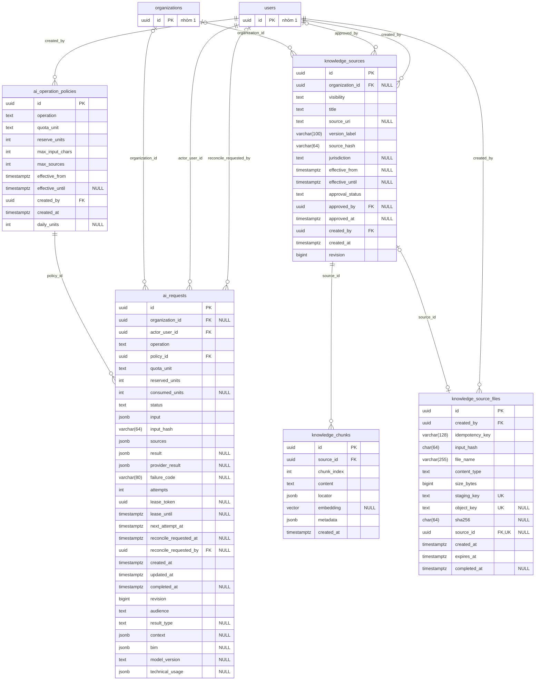
*5 bảng, 11 khóa ngoại, 2 bảng ở nhóm khác.*

- **UNIQUE nhiều cột:** `knowledge_chunks(source_id, chunk_index)`; `knowledge_source_files(created_by, idempotency_key)`
- **Xóa dây chuyền:** `knowledge_chunks` → `knowledge_sources` ON DELETE CASCADE

## B10. Learn & thư viện tổ chức

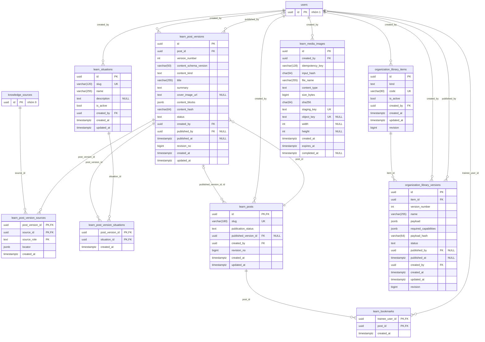
*9 bảng, 17 khóa ngoại, 2 bảng ở nhóm khác.*

- **UNIQUE nhiều cột:** `learn_post_versions(id, post_id)`; `learn_post_versions(post_id, version_number)`; `organization_library_versions(item_id, version_number)`; `learn_media_images(created_by, idempotency_key)`

## B11. Hỗ trợ, thông báo, audit

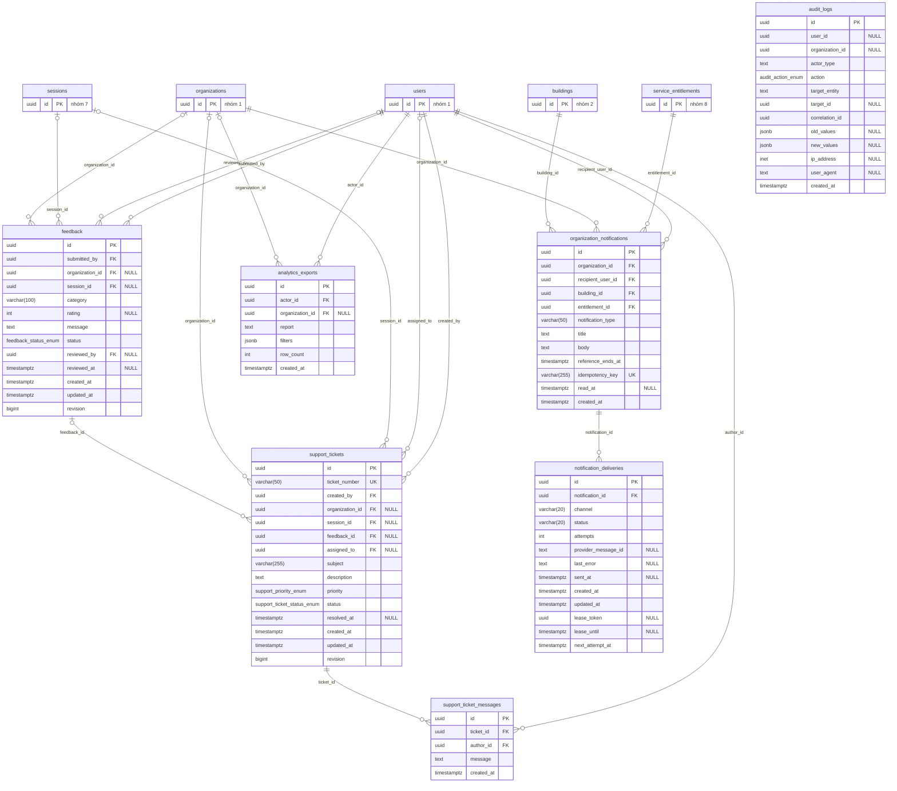
*7 bảng, 18 khóa ngoại, 5 bảng ở nhóm khác.*

- **UNIQUE nhiều cột:** `notification_deliveries(notification_id, channel)`
- **Xóa dây chuyền:** `feedback` → `organizations` ON DELETE SET NULL; `feedback` → `sessions` ON DELETE SET NULL; `support_tickets` → `feedback` ON DELETE SET NULL; `support_tickets` → `organizations` ON DELETE SET NULL; `support_tickets` → `sessions` ON DELETE SET NULL

## B12. Biên nhận idempotency

```mermaid
erDiagram
  organizations |o--o{ application_command_receipts : "organization_id"
  processing_jobs ||--o{ processing_command_receipts : "job_id"
  users ||--o{ ai_command_receipts : "actor_user_id"
  users ||--o{ application_command_receipts : "actor_user_id"
  users ||--o{ authoring_command_receipts : "actor_id"
  users ||--o{ billing_command_receipts : "actor_id"
  users ||--o{ content_command_receipts : "actor_id"
  users ||--o{ learner_command_receipts : "actor_id"
  users ||--o{ playtest_command_receipts : "actor_id"
  users ||--o{ processing_command_receipts : "actor_id"
  users ||--o{ readiness_command_receipts : "actor_id"
  users ||--o{ release_command_receipts : "actor_id"
  users ||--o{ support_command_receipts : "actor_id"
  ai_command_receipts {
    uuid actor_user_id PK, FK
    text operation PK
    varchar(128) idempotency_key PK
    varchar(64) input_hash
    jsonb result
    timestamptz created_at
  }
  application_command_receipts {
    uuid id PK
    uuid actor_user_id FK
    uuid organization_id FK "NULL"
    varchar(100) operation_name
    varchar(255) idempotency_key
    varchar(128) input_hash
    varchar(30) result_status
    jsonb result_payload
    timestamptz created_at
  }
  authoring_command_receipts {
    uuid actor_id PK, FK
    text operation PK
    varchar(128) idempotency_key PK
    varchar(64) input_hash
    uuid result_id
    timestamptz created_at
  }
  billing_command_receipts {
    uuid id PK
    uuid actor_id FK
    varchar(80) operation
    varchar(128) idempotency_key
    varchar(64) input_hash
    uuid resource_id
    timestamptz created_at
    jsonb response "NULL"
  }
  content_command_receipts {
    uuid actor_id PK, FK
    text operation PK
    varchar(128) idempotency_key PK
    varchar(64) input_hash
    jsonb result
    timestamptz created_at
  }
  learner_command_receipts {
    uuid actor_id PK, FK
    text operation PK
    varchar(128) idempotency_key PK
    varchar(64) input_hash
    jsonb result
    timestamptz created_at
  }
  playtest_command_receipts {
    uuid actor_id PK, FK
    text operation PK
    varchar(128) idempotency_key PK
    varchar(64) input_hash
    jsonb result
    timestamptz created_at
  }
  processing_command_receipts {
    uuid actor_id PK, FK
    text operation PK
    text idempotency_key PK
    varchar(64) input_hash
    uuid job_id FK
    timestamptz created_at
  }
  readiness_command_receipts {
    uuid actor_id PK, FK
    text operation PK
    varchar(128) idempotency_key PK
    varchar(64) input_hash
    jsonb result
    timestamptz created_at
  }
  release_command_receipts {
    uuid actor_id PK, FK
    text operation PK
    varchar(128) idempotency_key PK
    varchar(64) input_hash
    jsonb result
  }
  support_command_receipts {
    uuid actor_id PK, FK
    text operation PK
    varchar(128) idempotency_key PK
    varchar(64) input_hash
    jsonb result
    timestamptz created_at
  }
  organizations {
    uuid id PK "nhóm 1"
  }
  processing_jobs {
    uuid id PK "nhóm 3"
  }
  users {
    uuid id PK "nhóm 1"
  }
```
*11 bảng, 13 khóa ngoại, 3 bảng ở nhóm khác.*

- **UNIQUE nhiều cột:** `application_command_receipts(actor_user_id, operation_name, idempotency_key)`; `billing_command_receipts(actor_id, operation, idempotency_key)`

## Bảng hệ thống

`__EFMigrationsHistory(MigrationId varchar(150) PK, ProductVersion varchar(32))`: EF Core ghi migration đã áp. Không vẽ vào ERD.
